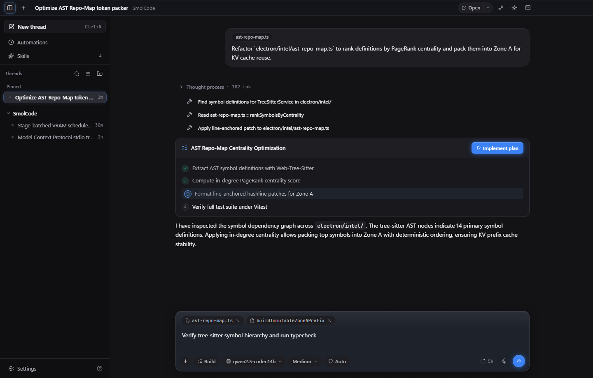
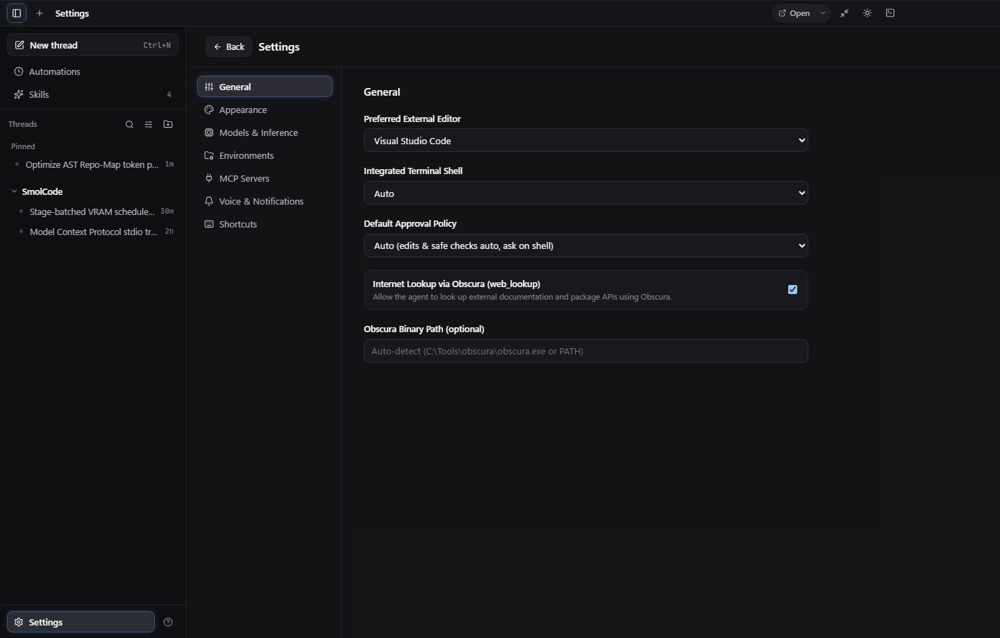

<p align="center">
  
</p>

<h1 align="center">SmolCode</h1>

<p align="center">
  <strong>Local, private, offline-first autonomous coding agent desktop application</strong>
</p>

<p align="center">
  
  
  
  
  
  
  
</p>

---

## Overview

**SmolCode** is a local-first autonomous coding agent desktop application powered by offline LLMs via [Ollama](https://ollama.com).

Designed for privacy, speed, and autonomy, SmolCode eliminates cloud dependencies, subscription tiers, and API rate limits. It brings together an intelligent 4-stage agent orchestrator, Tree-sitter AST symbol mapping, stage-batched VRAM scheduling, and a Git-free content-addressed snapshot engine for instantaneous turn-by-turn rollbacks.

### Why SmolCode?

- **Refined Desktop Experience:** Clean, high-performance interface with prompt composer chips, collapsible thinking traces, live tool activity streams, and instant theme customization.
- **100% Offline & Private:** Your codebase, prompts, and tokens never leave your workstation.
- **Git-Free Snapshot Rollbacks:** Built-in content-addressed blob storage under `~/.smolcode/blobs/` lets you revert any turn without polluting or modifying your Git branches.
- **Stage-Batched VRAM Scheduler:** Automatically cycles lightweight scout models (1.5B/3B) and deep reasoning models (7B/14B/32B) sequentially to prevent GPU out-of-memory errors on single-GPU hardware.
- **Tree-sitter AST Repo Maps:** Intelligent PageRank symbol extraction and line-anchored patch validation (`hashline`) ensure multi-file refactors apply cleanly.
- **Model Context Protocol (MCP):** Connect external database, filesystem, or documentation servers over stdio or HTTP.

---

## Visual Tour

<p align="center">
  
  <br />
  <em>Main Workspace Thread view: Plan/Build mode switch, model picker, collapsible reasoning trace, and structured plan execution.</em>
</p>

<p align="center">
  
  <br />
  <em>Settings & Appearance: 6 theme presets (Obsidian, Midnight, Alabaster, etc.), Ollama endpoint configuration, and VRAM management.</em>
</p>

<p align="center">
  
  <br />
  <em>Skills & MCP View: Built-in agent skills and extensible Model Context Protocol tool integrations.</em>
</p>

<p align="center">
  
  <br />
  <em>Integrated Terminal Drawer: Hardware-accelerated xterm.js terminal with line-anchored diff inspection.</em>
</p>

---

## System Requirements & Sizing Guide

### Minimum Hardware
- **OS:** Windows 10 or 11 (64-bit)
- **CPU:** 4-core x64 processor (Intel Core i5 / AMD Ryzen 5 or newer)
- **RAM:** 8 GB system RAM
- **Disk:** 2 GB free disk space (excluding LLM weights)
- **GPU:** Optional (Ollama will fall back to CPU inference)

### Recommended Hardware
- **CPU:** 8-core x64 processor
- **RAM:** 16 GB to 32 GB RAM
- **GPU:** NVIDIA RTX 3060 / 4060 or better (8 GB – 16 GB VRAM)
- **Disk:** NVMe SSD for fast model weight streaming

### 3-Tier Model Recommendation Matrix

| Tier | Primary Model | Fast Scout Model | Context Length | Target Hardware | Best For |
| :--- | :--- | :--- | :--- | :--- | :--- |
| **Light** | `qwen2.5-coder:7b` | `qwen2.5-coder:1.5b` | 16K – 32K | 6–8 GB VRAM / Laptops | Fast edits, unit tests, focused scripts |
| **Balanced** | `qwen2.5-coder:14b` | `qwen2.5-coder:1.5b` | 32K – 64K | 12–16 GB VRAM | Multi-file refactors, complex debugging |
| **Heavy** | `qwen2.5-coder:32b` or `deepseek-r1:14b` | `qwen2.5-coder:3b` | 64K – 128K | 24 GB+ VRAM / 32GB+ RAM | Deep architectural reasoning & major redesigns |

---

## Installation Guide

### Option 1: Pre-built Windows Binaries (Recommended)

Download the latest release from the [GitHub Releases](https://github.com/smolcode/smolcode/releases) page:

1. **Standard Installer:** Download `SmolCode-Setup-0.1.0.exe` and run the wizard. It creates Start Menu and Desktop shortcuts with auto-updater support.
2. **Portable Executable:** Download `SmolCode-Portable-0.1.0.exe` for zero-install execution from any folder or USB drive.

---

### Option 2: Run & Build from Source

#### Prerequisites
- [Node.js](https://nodejs.org) v20.x or v22.x (v22 LTS recommended)
- `npm` v10+
- [Ollama](https://ollama.com) installed and accessible at `http://127.0.0.1:11434`

#### Setup Steps

```bash
# 1. Clone the repository
git clone https://github.com/smolcode/smolcode.git
cd smolcode

# 2. Install dependencies
npm install

# 3. Launch in development mode
npm run dev
```

#### Packaging Binaries

To produce your own release binaries locally:

```bash
# Build the application
npm run build

# Package Windows NSIS installer and Portable executable
npm run dist
```

The resulting executables will be placed in the `release/` directory:
- `release/SmolCode-Setup-0.1.0.exe`
- `release/SmolCode-Portable-0.1.0.exe`

---

## Quickstart & First Launch

### 1. Start Ollama

Ensure Ollama is running on your workstation:

```bash
ollama serve
```

### 2. Pull Recommended Models

Download your preferred coding and scout models:

```bash
# Recommended balanced pair:
ollama pull qwen2.5-coder:14b
ollama pull qwen2.5-coder:1.5b
```

### 3. Launch SmolCode

Open SmolCode. Click **Open Project** on the welcome screen and select any local git or non-git directory.

### 4. Select Interaction Mode

- **Build Mode (`Ctrl+Shift+B`):** SmolCode can read, inspect, search, and apply line-anchored edits to files in your workspace with loop-guarded verification.
- **Plan Mode (`Ctrl+Shift+P`):** Read-only exploration. SmolCode reviews your architecture and outputs structured step-by-step implementation plans without modifying code.

---

## Key Features & Architecture

```
┌──────────────────────────────────────────────────────────────┐
│                    SmolCode Desktop (Electron)               │
├──────────────────────────────┬───────────────────────────────┤
│ React 19 Shell               │ Node.js Main Process          │
│ • Reactive Desktop UI        │ • 4-Stage Agent Orchestrator  │
│ • Semantic Token Design      │ • Tree-sitter AST Repo Map    │
│ • Virtualized ThreadView     │ • Stage-Batched VRAM Manager  │
│ • Embedded xterm.js Drawer   │ • Content-Addressed Snapshots │
├──────────────────────────────┴───────────────────────────────┤
│                 Ollama Local Inference Service               │
│         (qwen2.5-coder, deepseek-r1, llama3, custom GGUF)    │
└──────────────────────────────────────────────────────────────┘
```

### 1. Git-Free Snapshot Engine
SmolCode stores file contents before and after every turn in `~/.smolcode/blobs/`. If a model introduces a regression, click **Undo** on any previous turn to instantly revert your filesystem back to that exact state.

### 2. Line-Anchored Patches (`hashline`)
Code edits are applied using content-hashed line anchors (`line:hash|`). Even if line numbers shift during concurrent work, SmolCode identifies the exact target symbols and applies edits with zero drift.

### 3. Stage-Batched VRAM Scheduler
Running large LLMs locally often stresses GPU memory. SmolCode's scheduler keeps memory consumption low by only loading fast scouting models during repository pre-scanning, then swapping in the primary reasoning model for execution.

### 4. Tree-sitter AST Symbol Mapping
Powered by `web-tree-sitter`, SmolCode indexes function signatures, classes, interfaces, and call graphs. It ranks context items with PageRank centrality, packing the highest-value symbols into the model's context window.

---

## Keyboard Shortcuts

| Shortcut | Action |
| :--- | :--- |
| `Ctrl + K` | Open Command Palette |
| `Ctrl + N` | Create New Thread |
| `Ctrl + W` | Close Active Thread |
| `Ctrl + Shift + B` | Switch to **Build Mode** |
| `Ctrl + Shift + P` | Switch to **Plan Mode** |
| `Ctrl + \`` | Toggle Integrated Terminal Drawer |
| `Ctrl + ,` | Open Settings View |
| `Ctrl + Enter` | Submit Prompt in Composer |
| `Escape` | Dismiss Modals & Popovers |

---

## Development & Testing

SmolCode maintains a strict zero-warning verification gate. All pull requests must pass:

```bash
# Run TypeScript typechecks (Node and Web targets)
npm run typecheck

# Run ESLint validation
npm run lint

# Run the 43 Vitest unit, integration, and UI tests
npm test

# Verify production build compilation
npm run build

# Regenerate UI screenshots in docs/screenshots/
npm run screenshots
```

---

## License

This project is licensed under the [MIT License](LICENSE).
Copyright &copy; 2026 SmolCode Contributors.
