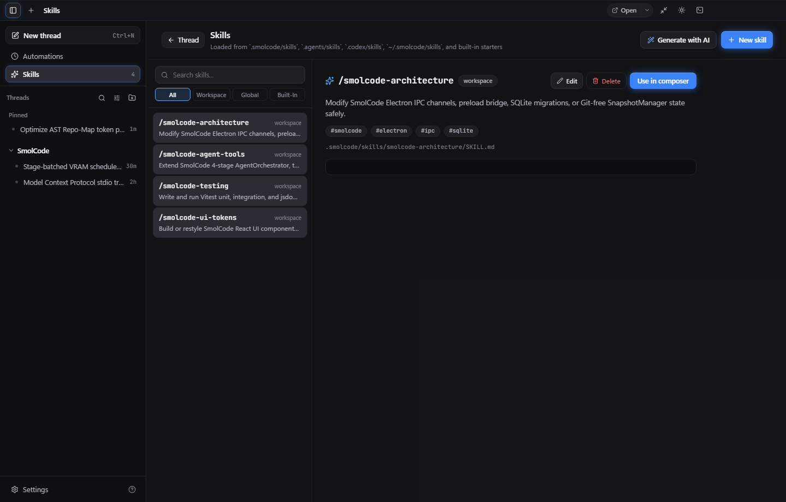
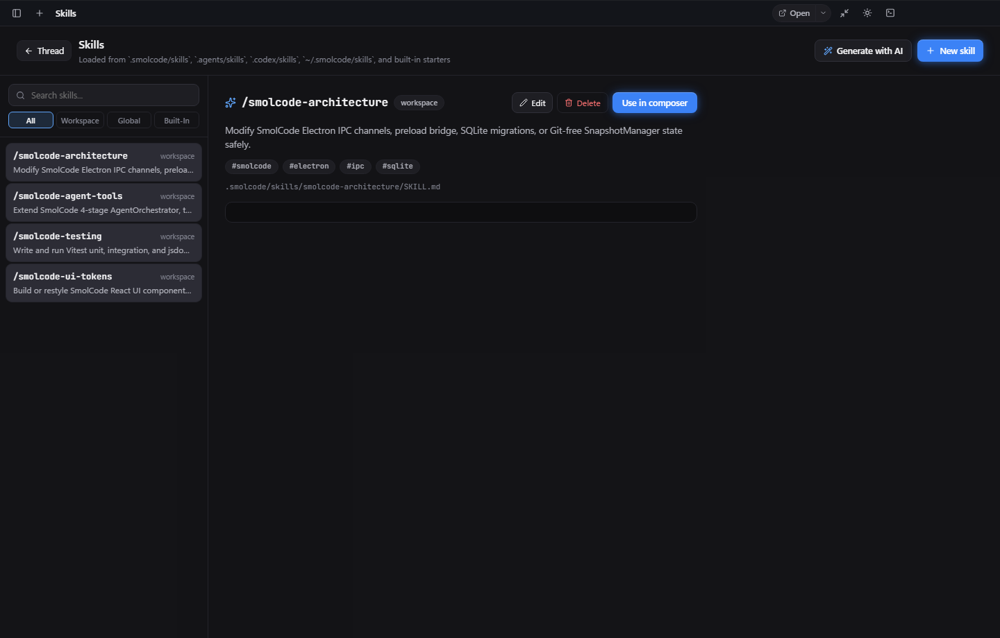

<p align="center">
  
</p>

<h1 align="center">SmolCode</h1>

<p align="center">
  A local desktop app for running coding agents with local Ollama models.
</p>

<p align="center">
  <a href="https://github.com/smolcode/smolcode/releases"></a>
  
  
  
</p>

---

SmolCode is an Electron-based coding agent desktop application that runs against your local [Ollama](https://ollama.com) instance. It indexes your workspace, plans and applies edits across files, and lets you roll back changes turn-by-turn without touching your git history.

All inference runs on your own hardware—no cloud accounts, API keys, or telemetry required.

---

## Screenshots

<p align="center">
  
  <br />
  <em>Workspace thread with model picker, thinking trace, and structured plan card.</em>
</p>

<p align="center">
  
  <br />
  <em>Settings view for theme presets, Ollama host URL, and VRAM scheduling.</em>
</p>

<p align="center">
  
  <br />
  <em>Skills catalog and Model Context Protocol (MCP) server manager.</em>
</p>

<p align="center">
  
  <br />
  <em>Integrated xterm.js terminal drawer and line-anchored diff viewer.</em>
</p>

---

## Features

- **Local Ollama inference:** Works out-of-the-box with coding models like `qwen2.5-coder`, `deepseek-r1`, and `llama3`. Supports dual-model setups (fast scout model for initial symbol lookups + main model for reasoning and edits).
- **VRAM stage scheduling:** When working with limited GPU memory, SmolCode can batch stages sequentially, unloading or switching models between scanning and editing to prevent CUDA OOMs.
- **Git-free snapshot rollbacks:** Stores file snapshots before each turn in `~/.smolcode/blobs/`. If a generated patch causes regressions, click undo to immediately restore the working tree to the previous turn without dirtying your git commit history or creating temporary stashes.
- **Line-anchored patches (`hashline`):** Code edits target specific content-hashed lines (`line:hash|`). When multiple files are modified or lines shift, edits apply cleanly with zero drift.
- **AST repo mapping:** Uses `web-tree-sitter` to parse code structure, extract symbols, and calculate in-degree centrality, packing the most relevant interfaces and signatures into the prompt.
- **Model Context Protocol (MCP):** Connect external tool servers (databases, web scrapers, docs fetchers) over stdio or HTTP.
- **Integrated terminal:** Built-in xterm.js drawer with node-pty for quick shell commands, linting, or test execution alongside the agent thread.
- **Build & Plan modes:** Toggle between **Build Mode** (`Ctrl+Shift+B`) for active code changes and **Plan Mode** (`Ctrl+Shift+P`) for read-only architectural specs and step-by-step proposals.

---

## Hardware & Model Recommendations

SmolCode runs fully offline. Performance depends primarily on your GPU VRAM and model parameter size.

| Model Tier | Primary Model | Scout Model | Context | Minimum Hardware | Best For |
| :--- | :--- | :--- | :--- | :--- | :--- |
| **Light** | `qwen2.5-coder:7b` | `qwen2.5-coder:1.5b` | 16K–32K | 6–8 GB VRAM (or 16 GB system RAM) | Fast fixes, single-file scripts, unit tests |
| **Balanced** | `qwen2.5-coder:14b` | `qwen2.5-coder:1.5b` | 32K–64K | 12–16 GB VRAM | Multi-file refactors, debugging |
| **Heavy** | `qwen2.5-coder:32b` / `deepseek-r1:14b` | `qwen2.5-coder:3b` | 64K–128K | 24 GB VRAM (or 32 GB+ RAM) | Complex architectural reasoning |

---

## Installation

### Pre-built Windows Binaries

Grab the latest release from the [GitHub Releases](https://github.com/smolcode/smolcode/releases) page:

- **Installer:** `SmolCode-Setup-0.1.0.exe` (standard Windows installer with desktop and start menu shortcuts)
- **Portable:** `SmolCode-Portable-0.1.0.exe` (single executable, runs directly with no installation)

---

### Running from Source

You will need [Node.js](https://nodejs.org) (v20 or v22) and `npm`.

```bash
# Clone the repository
git clone https://github.com/smolcode/smolcode.git
cd smolcode

# Install dependencies
npm install

# Start in development mode
npm run dev
```

To package executables locally:

```bash
# Build production bundle
npm run build

# Generate Windows installer and portable binary in release/
npm run dist
```

---

## Quickstart

1. **Start Ollama:**
   Make sure Ollama is running locally on port 11434:
   ```bash
   ollama serve
   ```

2. **Pull a model:**
   ```bash
   ollama pull qwen2.5-coder:14b
   ollama pull qwen2.5-coder:1.5b
   ```

3. **Open a project:**
   Launch SmolCode, click **Open Project**, and select any folder.

4. **Pick a mode:**
   - Use **Build Mode** (`Ctrl+Shift+B`) to let the agent read and edit files.
   - Use **Plan Mode** (`Ctrl+Shift+P`) if you want the agent to analyze the repo and generate a step-by-step proposal before modifying anything.

---

## Architecture Overview

```
┌─────────────────────────────────────────────────────────────┐
│                    SmolCode Electron Shell                  │
├─────────────────────────────┬───────────────────────────────┤
│ Frontend (React 19)         │ Main Process (Node.js)        │
│ • Virtualized thread view   │ • Agent orchestrator          │
│ • Prompt composer & chips   │ • Tree-sitter AST indexer     │
│ • xterm.js terminal drawer  │ • VRAM stage scheduler        │
│ • Token theme engine        │ • Blob-based snapshot manager │
├─────────────────────────────┴───────────────────────────────┤
│                   Local Ollama Instance                     │
│         (qwen2.5-coder, deepseek-r1, llama3, etc.)          │
└─────────────────────────────────────────────────────────────┘
```

- **Database:** Local SQLite database at `~/.smolcode/smolcode.db` stores thread history, projects, and custom skills.
- **Snapshots:** Content-addressed file blobs are saved in `~/.smolcode/blobs/`. Reverting a turn writes the historical file contents directly back to the workspace.

---

## Keyboard Shortcuts

| Shortcut | Description |
| :--- | :--- |
| `Ctrl + K` | Open command palette |
| `Ctrl + N` | New thread |
| `Ctrl + W` | Close active thread |
| `Ctrl + Shift + B` | Switch to Build Mode |
| `Ctrl + Shift + P` | Switch to Plan Mode |
| `Ctrl + \`` | Toggle terminal drawer |
| `Ctrl + ,` | Open Settings |
| `Ctrl + Enter` | Send prompt |
| `Escape` | Close modals / popovers |

---

## Development

```bash
# Typecheck Node and Web targets
npm run typecheck

# Lint with ESLint
npm run lint

# Run Vitest suite (43 tests)
npm test

# Build production bundle
npm run build

# Regenerate app icons
npm run icons

# Regenerate UI screenshots in docs/screenshots/
npm run screenshots
```

---

## License

[MIT License](LICENSE) &copy; 2026 SmolCode Contributors.
